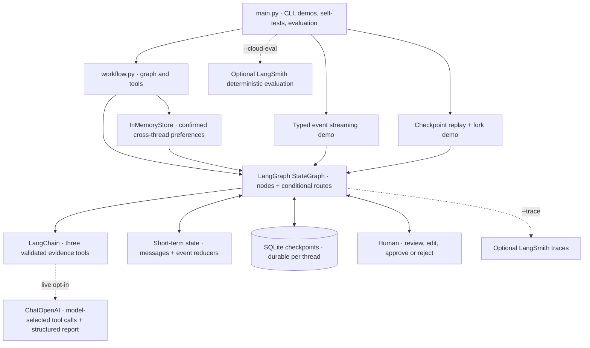
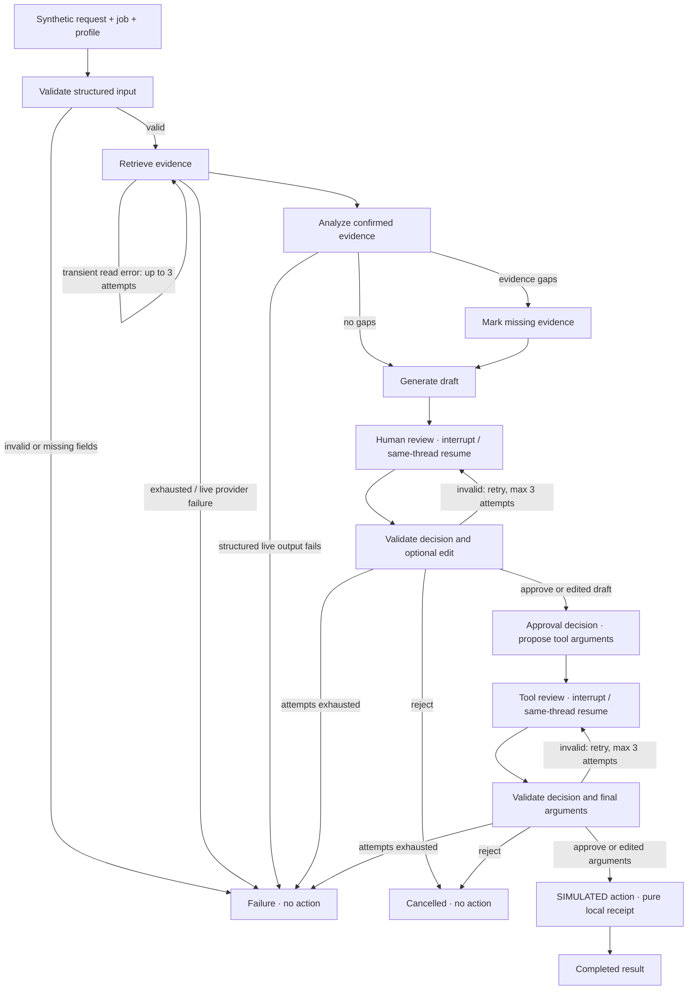

# GraphGate · LangChain + LangGraph Learning Lab

**Trace the graph. Review the draft. Decide what happens next.**

A terminal-first Python lab for tools, state, human decisions and replay—contained in **two Python source files**.


> **Educational demonstration, not a production-ready AI service.** Uses fictional jobs, synthetic profiles and pure local action receipts. No email or application is sent. Offline mode needs no API key.

[Quick start](#quick-start) · [Workflow](#workflow) · [Human review](#human-review) · [Memory](#memory-and-checkpoints) · [Verification](#evaluation-and-testing) · [Limitations](#security-and-limitations)

## Architecture



**Stack:** Python · LangChain · LangGraph · Pydantic · SQLite · optional OpenAI integration and LangSmith SDK.

## Workflow



Offline selection is deterministic simulation; live selection uses actual model-emitted tool calls. Provider connection/timeouts/rate-limit errors have a separate **two-attempt** bound and 20-second request timeout. The simulated action has **no automatic retry**.

## Feature overview

| Capability | Status | Menu |
|---|---|---|
| LangChain evidence tools and argument validation | Offline tested | 3 |
| Live model tool calling and structured output | Implemented; live integration not tested | 2 |
| Typed StateGraph, normal edges and conditional routing | Tested | 1, 4 |
| HITL approval / rejection | Tested at both gates | 7 |
| Review and draft editing | Tested; resumed action uses edits | 8 |
| Tool-call approval and argument editing | Tested | 9 |
| Human input validation and re-prompting | Tested; three attempts per gate | 10 |
| Short-term message/state continuity | Tested | 5 |
| Long-term Store operations across threads | Tested; process lifetime only | 6 |
| Durable checkpointing and interrupt/resume | Tested, including separate-process recovery | 11 |
| Static debugging breakpoint | Tested | 12 |
| Typed streaming: state, interrupt, output | Tested offline; live tokens unverified | 13 |
| Time travel, replay and checkpoint fork | Tested | 14 |
| Error handling and bounded read retries | Tested with injected failures | 15 |
| LangSmith tracing | Optional; disabled path tested, cloud unverified | 18 |
| Deterministic offline evaluation | 7/7 cases passed | 17 |
| Embedded automated self-tests | 21/21 passed | 16 |

## Quick start

**Python 3.11+**; verified on **3.12.4 / macOS ARM64**. Pinned dependencies are in `requirements.txt`.
Create the virtual environment outside the repository to keep the source tree limited to two Python files:

```sh
git clone https://github.com/mustafasabahy/langchain-langgraph-learning-lab.git
cd langchain-langgraph-learning-lab
python3 -m venv ../graphgate-venv
source ../graphgate-venv/bin/activate
python -m pip install -r requirements.txt
python main.py
```

For Windows PowerShell, activate with `..\graphgate-venv\Scripts\Activate.ps1`.
Only macOS execution has been verified. The menu has all **19 choices**, including exit.

```sh
python -m pip check
python -m py_compile workflow.py main.py
python main.py --self-test
python main.py --evaluate
python main.py --demo-all --database /tmp/graphgate-demo.sqlite
```

`--demo-all` is an explicitly scripted offline harness: fixture decisions replace human input only in this harness. Ordinary menu demonstrations ask the human. Mandatory test failures produce a nonzero exit code. Do not use `python -O` for tests: assertions are part of verification.

### Optional live provider

Set `OPENAI_API_KEY` privately in your shell. No `.env` loader is used.

```sh
export DEMO_LIVE=1
export OPENAI_PROVIDER=openai
export OPENAI_MODEL='<model supporting tool calls and JSON-schema output>'
python main.py --live
# Optional live token/message projection:
python main.py --live-stream
```

The live path requires all three read tools within five model rounds, then requests a structured report. Unsupported output or provider failure fails visibly; there is no silent offline fallback.

### Optional LangSmith

Set `LANGSMITH_API_KEY` privately; use a project-based workspace:

```sh
export LANGSMITH_TRACING=true
export LANGSMITH_PROJECT=synthetic-learning-demo
python main.py --demo 1 --trace
# Explicit upload of synthetic offline evaluation cases/results:
python main.py --cloud-eval
```

Without `--trace`, tracing is explicitly disabled even if ambient environment flags enable it. Account configuration may also require `LANGSMITH_ENDPOINT` or `LANGSMITH_WORKSPACE_ID`. Graph nodes, tools and live model calls participate in tracing. Console logs do not prove cloud delivery. Agent-based workspace provisioning is not implemented. Cloud evaluation uses a deterministic evaluator, **not an LLM judge**. Live and cloud commands are documented paths, not verified integration results.

## Human review

```mermaid
sequenceDiagram
    participant CLI as main.py
    participant G as LangGraph
    participant DB as SQLite checkpoint
    participant H as Human
    CLI->>G: Invoke with stable thread_id
    G->>DB: Save state at interrupt
    G-->>CLI: Review payload + draft/report
    CLI->>H: Show proposed content
    H->>CLI: Approve, reject or edit JSON
    CLI->>G: Command(resume=answer), same thread_id
    G->>G: Validate; route or re-prompt
    Note over G,H: Draft acceptance opens a second tool-argument review
    G-->>CLI: Cancel, re-prompt, or approved simulation receipt
```

| Decision | Example | Effect |
|---|---|---|
| Approve | `{"decision":"approve"}` | Continue to the next gate or simulated action |
| Reject | `{"decision":"reject"}` | Cancel without an action receipt |
| Edit draft | `{"decision":"edit","draft":"Human revision"}` | Preserve edited draft in resumed state |
| Edit tool arguments | `{"decision":"edit","arguments":{"destination":"local-archive","content":"Edited content"}}` | Validate and use final arguments |
| Pause | Type `pause` at the prompt | Leave the SQLite checkpoint saved |

Only `local-preview` and `local-archive` destinations are accepted; both are labels in a receipt, **not filesystem or external actions**. Invalid input routes back through graph edges; three invalid answers at either gate stop the run.

Menu 11 prints a thread ID. Reopen the **same database and thread**:

```sh
python main.py --thread THE_PRINTED_ID --resume
# For a custom database, add --database /path/to/checkpoints.sqlite
```

A different ID identifies a different thread; completed threads reject stale resumes. Static debug breakpoints continue with `invoke(None, config)`; dynamic human gates use `Command(resume=...)`.

## Memory and checkpoints

| Concept | Purpose | Lifetime | Demonstration |
|---|---|---|---|
| Short-term state | Messages, job/profile, report and workflow events | Within a thread; persisted by its checkpointer | Menu 5 supplies only a follow-up request |
| Checkpoint persistence | Resume execution, inspect history, replay/fork | SQLite survives process restarts | Menu 11; separate-process recovery test |
| Long-term memory | Confirmed preferences shared across threads | InMemoryStore lasts one process/menu session | Menu 6 confirms, retrieves, corrects and deletes |

Resuming restores **where execution stopped**. Store retrieval supplies **a confirmed preference to another thread**. They are separate mechanisms. Historical checkpoints can retain an old preference snapshot after the Store entry is deleted.

## Example output

Actual result excerpt from an offline invocation with two approved human decisions; the variable thread ID and unrelated fields are omitted:

```json
{
  "status": "completed",
  "report": {
    "matched": ["Python", "SQL"],
    "missing": [],
    "unsupported": [],
    "summary": "Confirmed evidence only; gaps are explicit."
  }
}
```

## Evaluation and testing

Latest release preparation: **2026-10-29**, Python 3.12.4.

| Executed check | Result |
|---|---|
| `python -m pip check` | No broken requirements |
| `python -m py_compile workflow.py main.py` | Both compiled |
| `python main.py --self-test --report VERIFICATION.md` | **21 passed, 0 failed** |
| `python main.py --evaluate` | **7 passed, 0 failed** |
| `python main.py --demo-all --database /tmp/graphgate-demo.sqlite` | All 17 offline demos executed; live option skipped |

Cases cover strong match, missing evidence, unsupported claim, rejection, invalid human input, tool recovery and exhaustion. Self-tests additionally assert two approval gates, edit preservation, serializable interrupts, cross-thread Store operations, same-thread resume, separate-process recovery, static breaks, streaming and actual replay/fork.

**Skipped:** real provider calls, native model structured output, live tokens, cloud trace delivery and cloud evaluation. Model-based judging is not implemented. Deterministic checks do not benchmark model intelligence.

[Full documentation coverage matrix](VERIFICATION.md) · [Execution and release notes](EXECUTION.md)

## Project structure

```text
.
├── main.py             # CLI, demonstrations, dataset and self-tests
├── workflow.py         # StateGraph, tools, persistence and model integration
├── requirements.txt    # Tested pinned dependency snapshot
├── README.md           # Visual learning guide
├── VERIFICATION.md     # Executed-test coverage matrix
├── EXECUTION.md        # Reproducible checks and limitations
└── .gitignore          # Secrets, runtime state and local artifacts excluded
```

Exactly two **Python source files**, with supporting documentation/configuration. No extra Python modules, test files or notebooks.

## Security and limitations

- Use synthetic inputs only. No real emails, applications or external actions are implemented.
- Supply credentials through private environment variables or a secrets manager. `.env` files, keys, environments, SQLite databases, logs and local transcripts are excluded from Git.
- LangSmith is optional and explicitly enabled. Its live/cloud paths remain unverified.
- Input is structured job/profile data, not free-text document extraction. Skill matching uses exact keys; unsupported claims are not corroborated facts.
- Store memory is ephemeral; messages are untrimmed; replay/fork advances the latest checkpoint pointer in its isolated thread while preserving original checkpoints.
- Local single-user persistence, deterministic fixtures and passing tests do not establish production security, reliability, hiring quality or scalability.
- No CI result, coverage percentage, release version or production certification is claimed. This project is independent of CareerPilot.

## Learning roadmap

1. Understand typed graph state and small nodes in `workflow.py`.
2. Follow evidence tools and conditional routes: menus **3–4**.
3. Observe an interrupt and resume the same thread: menu **11**.
4. Experiment with approval, rejection, editing and validation: menus **7–10**.
5. Compare thread state, checkpoints and Store memory: menus **5–6**.
6. Explore static debugging, streaming and replay: menus **12–14**.
7. Run self-tests and deterministic evaluation: menus **16–17**.
8. Enable optional live integrations after reviewing their configuration: menus **2,18**.
